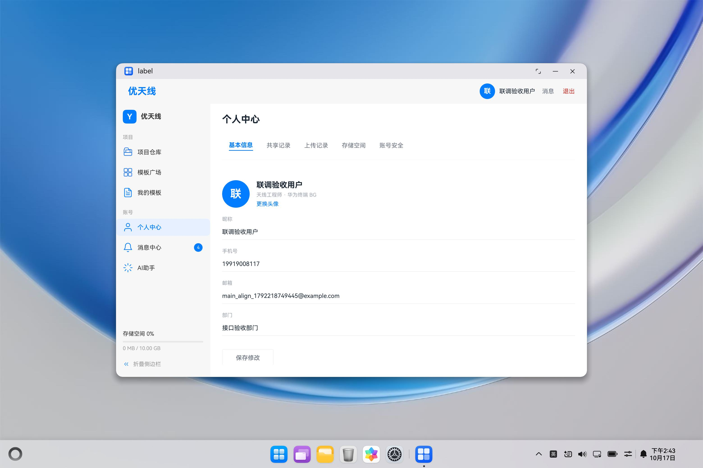

# 优天线 ArkTS：dev 接口对齐版本

本版本使用原始 main 的界面、样式和布局，对接真实后端的登录及个人中心接口。登录后进入“个人中心 → 基本信息”。没有示例预览入口，也不会绕过认证。

## 克隆和环境

```powershell
git clone --branch dev --single-branch https://github.com/renmengjiao/YouTianXian_arkTS.git
Set-Location .\YouTianXian_arkTS
$env:TASK_IDE_HOME = 'C:\Program Files\Huawei\DevEco Studio' # 换成自己的实际安装目录
```

- Windows、Git、Windows PowerShell 5.1 或更高版本。
- DevEco Studio，使用其内置 Node、Java、OHPM、Hvigor 和 HarmonyOS SDK；不需要本仓库维护者的磁盘目录。
- 本次实测 SDK 为 HarmonyOS 26.0.0.105，模拟器为 MateBook 2in1 API26，屏幕 3120×2080；项目兼容版本仍为 6.1.1(24)。相同屏幕和窗口尺寸可复现相同布局；手机、不同窗口宽度会按原 main 的响应式断点显示。
- 已启动并解锁的 MateBook 2in1 API26+ 模拟器。启动脚本不改变窗口大小。
- 可用的匹配版本后端，以及一个该后端上的真实账号。

## 后端版本和地址

对应后端仓库：[u-antenna-backend](https://github.com/liuhuaxu463/u-antenna-backend/tree/dev)，已验证提交为 `a7ec81be66b42af2e38cc0620ecf93530eba1340`。

需要自建后端时：

```powershell
git clone --branch dev https://github.com/liuhuaxu463/u-antenna-backend.git
Set-Location .\u-antenna-backend
git checkout a7ec81be66b42af2e38cc0620ecf93530eba1340
# 配置 Java 21、匹配的开发数据库和 Redis，再启动：
.\mvnw.cmd spring-boot:run
```

数据库连接由 `SPRING_DATASOURCE_URL`、`SPRING_DATASOURCE_USERNAME`、`SPRING_DATASOURCE_PASSWORD` 配置；Redis 由 `SPRING_DATA_REDIS_HOST`、`SPRING_DATA_REDIS_PORT` 配置。不要把自己的密码写入 Git。应使用后端维护者提供的开发数据库结构；后端 `src/test/resources/sql/test-schema.sql` 明确仅用于隔离测试，不是正式数据库安装脚本。

前端默认连接 `http://127.0.0.1:8080/api`。模拟器中的 127.0.0.1 通过 HDC 反向转发连接到**运行 HDC 的电脑**的 8080。其他作者应在自己的电脑启动后端，或修改 `products/default/src/main/ets/config/ApiConfig.ets` 中的 `BACKEND_ORIGIN` 为其可访问后端的 origin，然后重新构建。后端 URL 不能重复添加 `/api`。远程服务器模式下脚本不建立本机端口转发；其网络和 TLS 证书也必须能被模拟器访问。

前端仓库不包含数据库、已有用户、密码、令牌或开发者上传记录。不同数据库会产生不同资料、记录和存储数值；这不代表界面代码不同。要复现截图的业务数据，须连接同一份后端数据或自行准备等价的专用测试账号。

## 一条命令构建、安装和启动

回到前端仓库后运行：

```powershell
# 自动选择唯一已连接模拟器；有多个设备时必须明确指定 DeviceId。
powershell.exe -NoProfile -ExecutionPolicy Bypass -File .\scripts\run-dev.ps1

# 显式指定设备，地址从 HDC 的 list targets 获取：
& "$env:TASK_IDE_HOME\sdk\default\openharmony\toolchains\hdc.exe" list targets
powershell.exe -NoProfile -ExecutionPolicy Bypass -File .\scripts\run-dev.ps1 -DeviceId '127.0.0.1:5555'
```

`ExecutionPolicy Bypass` 仅作用于该 PowerShell 子进程，不修改系统执行策略。

脚本检查工具、模拟器类型、后端未认证响应及端口转发冲突；安装所有模块依赖，写入忽略的本地 SDK 配置，构建 debug HAP，停止旧进程后覆盖安装并启动。只有进程和登录/工作区界面连续两次检查就绪才报告成功；启动未就绪时最多尝试 3 次。它不依赖本机后端的启动脚本，不启动/清空数据库，不登录账号，不改窗口尺寸，也不覆盖指向其他服务的端口转发。

```powershell
# 仅检查：不构建、不安装、不修改转发。
powershell.exe -NoProfile -ExecutionPolicy Bypass -File .\scripts\run-dev.ps1 -Action Check
# 仅构建：不要求后端在线或模拟器启动。
powershell.exe -NoProfile -ExecutionPolicy Bypass -File .\scripts\run-dev.ps1 -Action Build
# 只安装已有 HAP 并启动。
powershell.exe -NoProfile -ExecutionPolicy Bypass -File .\scripts\run-dev.ps1 -Action Install
```

也可使用 `scripts\build-arkts.cmd` 和 `scripts\start-aligned.cmd --check/--build/--install`。构建日志位于 `.hvigor/logs/build-api26.log`，HAP 位于 `products/default/build/default/outputs/default/default-default-unsigned.hap`。

如 SDK 不在 DevEco 默认位置，可传 `-SdkHome` 或设置 `TASK_SDK_HOME`。指定目录需要包含 `default/openharmony/toolchains/hdc.exe`。本次实测模拟器接受 unsigned debug HAP；如果自己的模拟器要求签名，使用 DevEco 的个人调试签名后安装 signed HAP，不要提交签名密钥和个人签名路径。

## 登录和测试账号

登录输入框保留原 main 的“邮箱”占位文案，实际发送后端 `account` 字段，可输入该后端已有的用户名或手机号。本版本没有新增邮箱查找账号能力。

没有账号时，可通过后端已有注册 API 创建**新专用测试账号**，不用前端尚未对齐的验证码注册页：

```powershell
powershell.exe -NoProfile -ExecutionPolicy Bypass -File .\scripts\create-test-account.ps1 -Username 'my_alignment_test'
```

该脚本安全提示输入自己的密码，不输出或保存密码/令牌；仅注册新账号并设置该账号的测试昵称、邮箱和部门，不插入假的共享或上传记录，也不会覆盖已有同名用户。后端不在本机时加 `-BackendOrigin 'https://你的后端地址'`。

## 检查和验收

```powershell
& "$env:TASK_IDE_HOME\tools\node\node.exe" .\scripts\test-alignment.cjs
& "$env:TASK_IDE_HOME\tools\node\node.exe" .\scripts\check-visual.cjs
```

22 项接口/会话检查执行实际非 UI ArkTS 模块，平台网络和安全存储使用测试替身。视觉检查对比原始 main 提交 `34cfd7034e8d8745a61dea4af3db930559888225` 的资源、样式调用和组件顺序；请使用正常克隆而不是不含 Git 历史的 ZIP，浅克隆时需先取得该基线提交。

真实验收包含资料保存与回读、昵称同步、个人中心五个栏目、改密及旧密码失效、两处退出、记住/不记住登录的冷启动。后端指定测试为 134 项通过、1 项因既有组合外键缺口跳过。详细范围见 [接口对齐交付说明](接口对齐交付说明.md)。



注册、消息中心、项目/模板/AI、图片头像上传、通知设置页、登录记录页、手机解绑、生物识别和两步验证未扩展。原 main 的静态说明和消息角标保留；它们不应理解为已经接入真实数据。现有列表也没有增加翻页控件。
